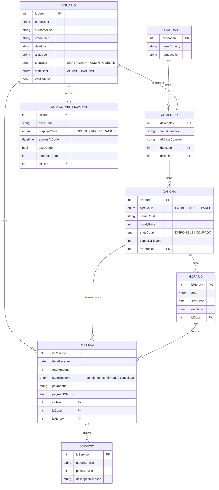

# Propuesta TP DSW

## Grupo
### Integrantes
* 55103 - Gallon, Francisco
* 53749 - Martínez, Santiago

### Repositorios
* [frontend app](https://github.com/TatoCanob74/frontendTPDWS)
* [backend app](https://github.com/TatoCanob74/backendTPDesarrollo)

## Tema
### Descripción
CanchaYa es una plataforma para reservar canchas de fútbol, tenis y pádel en distintos complejos deportivos. El cliente elige deporte, sede, complejo, día y horario, suma servicios opcionales (por ejemplo alquiler de pelota o pecheras) y paga la reserva con Mercado Pago. Cada complejo tiene un administrador que gestiona sus canchas, horarios y reservas, y un superadministrador gestiona la plataforma completa.

### Modelo

## Alcance Funcional

### Alcance Mínimo

Grupo de 2 integrantes.

Regularidad:
|Req|Detalle|
|:-|:-|
|CRUD simple|1. CRUD Localidad 2. CRUD Servicio|
|CRUD dependiente|1. CRUD Complejo {depende de} CRUD Localidad|
|Listado + detalle|1. Listado de reservas (panel de administración) filtrado por estado y fecha, muestra número, fecha, cancha, horario, monto y estado => detalle muestra cliente, complejo, sede, servicios contratados, total y estado del pago|
|CUU/Epic|1. Reservar una cancha|

Adicionales para Aprobación
|Req|Detalle|
|:-|:-|
|CRUD|1. CRUD Localidad 2. CRUD Servicio 3. CRUD Complejo 4. CRUD Cancha 5. CRUD Horario 6. CRUD Usuario (registro, perfil, alta de administradores, baja y activación por el superadmin) 7. CRUD Reserva|
|CUU/Epic|1. Reservar una cancha 2. Pagar una reserva con Mercado Pago (usa la reserva creada en el CUU 1 y la confirma al aprobarse el pago)|

### Alcance Adicional Voluntario

|Req|Detalle|
|:-|:-|
|Listados|1. Horarios filtrados por cancha, día y turno (mañana, tarde, noche) 2. Mis reservas del cliente, con detalle de cada una|
|CUU/Epic|1. Cancelar una reserva (hasta 6 horas antes) 2. Verificar el email al registrarse con un código de 6 dígitos 3. Recuperar la contraseña con un código por email|
|Otros|1. Integración con Mercado Pago (Checkout Pro, webhook y sincronización del estado de pago) 2. Tres niveles de acceso: cliente, administrador de complejo y superadministrador 3. Envío de mails con nodemailer (SMTP)|
